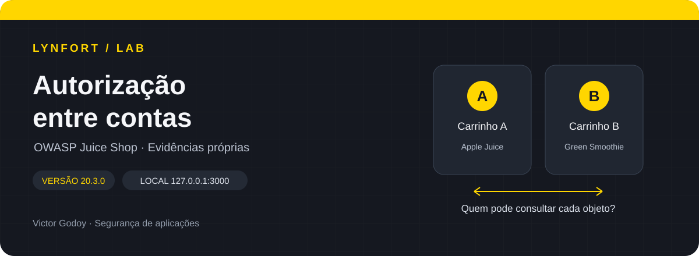
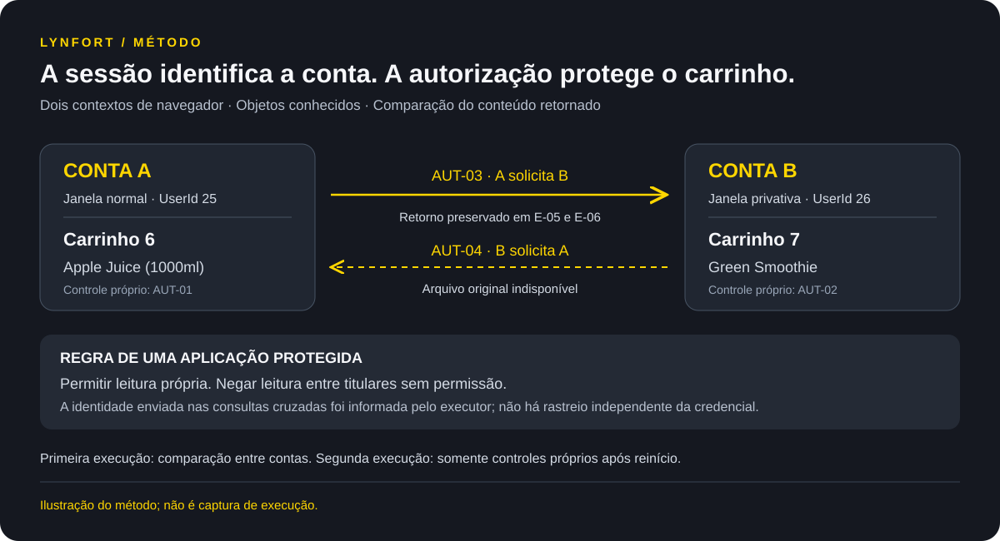
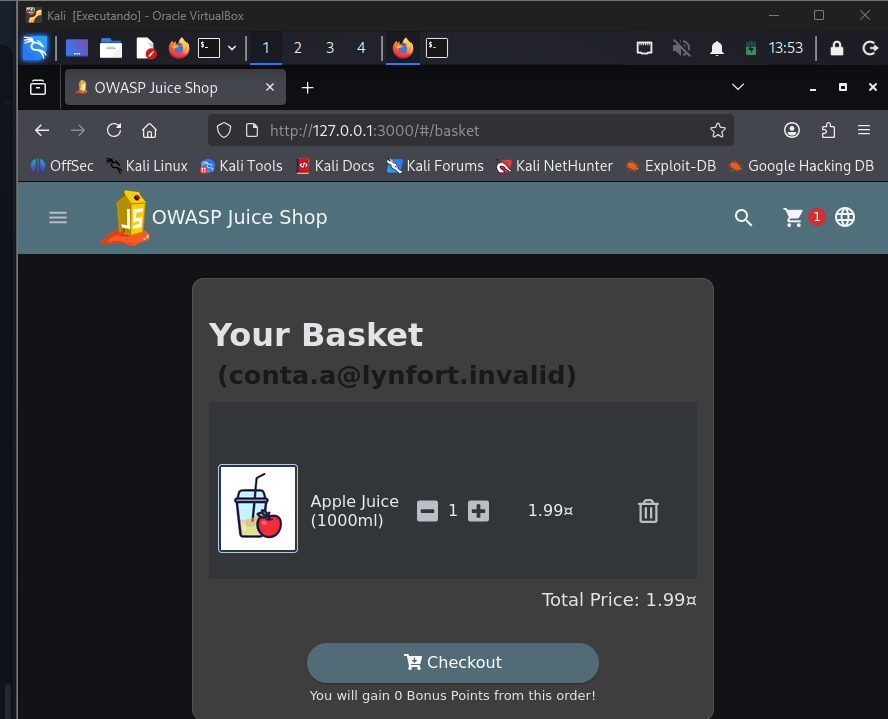
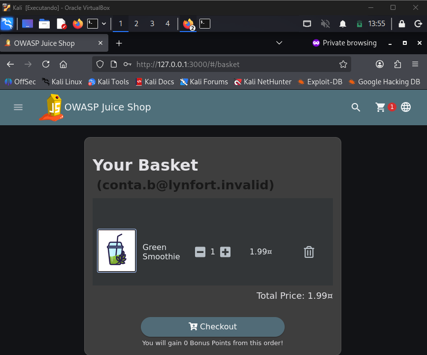
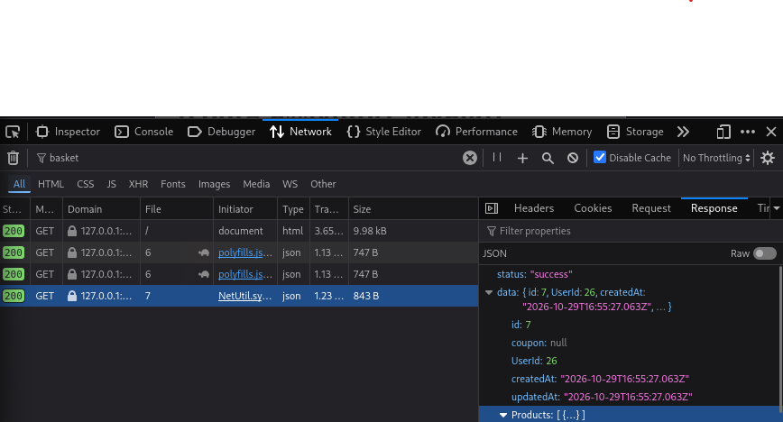
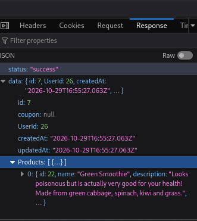

<div align="center">



**Segurança de aplicações · Autorização horizontal · Evidências próprias**

[Resumo gerencial](docs/relatorio-gerencial.md) · [Relatório técnico](docs/relatorio-tecnico.md) · [Matriz de testes](docs/matriz-de-testes.md) · [Evidências](evidencias/README.md)

</div>

# Lynfort Lab — Teste de autorização entre contas no Juice Shop

**Uma sessão válida pode ler o carrinho de outra conta?** Este laboratório investiga essa pergunta com duas contas fictícias no OWASP Juice Shop local. O trabalho reúne preparação do ambiente, controles de acesso legítimo, comparação entre carrinhos e análise do resultado.

O ambiente é intencionalmente vulnerável. O projeto documenta a reprodução didática do desafio **View Basket**, sem apresentar esse comportamento conhecido como descoberta inédita.

## Resultado e alcance

Na primeira execução, Victor relatou manter a autenticação da conta A e consultar o carrinho conhecido de B. As capturas preservadas mostram **HTTP 200, carrinho 7, UserId 26 e Green Smoothie**, o produto separado para B. A associação dessa consulta à sessão A depende da confirmação do executor; os cabeçalhos de autenticação não foram preservados.

O sentido B → A também foi acompanhado no histórico da conversa, com retorno do carrinho 6 e Apple Juice. O arquivo dessa captura deixou de estar disponível e **não integra o pacote**. Portanto, esse sentido tem documentação mais limitada e não possui imagem reconstruída.

| Caso | Consulta planejada | Resultado da primeira execução | Base |
| --- | --- | --- | --- |
| AUT-01 | A lê o próprio carrinho | Apple Juice no carrinho 6 | Tela da conta A; URL e JSON fornecidos pelo executor |
| AUT-02 | B lê o próprio carrinho | Green Smoothie no carrinho 7 | Tela da conta B; URL e JSON fornecidos pelo executor |
| AUT-03 | A solicita o carrinho B | Dados de B retornados, conforme procedimento relatado | Capturas do retorno + confirmação da sessão A |
| AUT-04 | B solicita o carrinho A | Dados de A observados no anexo do histórico | Arquivo da captura indisponível |

**Conclusão:** reprodução de leitura entre contas sustentada pelo procedimento relatado e pelas evidências disponíveis, com limites de rastreabilidade da credencial. Não foi feita verificação independente da sessão enviada. O conteúdo retornado, e não apenas o status 200, fundamenta a comparação.

Após um reinício, houve novo cadastro das contas e coleta de controles próprios. Esses registros formam a **execução 02**, sem repetição documentada dos acessos cruzados. Nenhuma correção foi implementada ou validada no Juice Shop.

## Ambiente do laboratório

| Item | Registro |
| --- | --- |
| Aplicação | OWASP Juice Shop **20.3.0**, conforme consulta no contêiner |
| Plataforma | Kali Linux em VirtualBox, hospedado no Windows |
| Contêiner / imagem | `juice-shop` / `bkimminich/juice-shop` |
| Endereço | `http://127.0.0.1:3000`, dentro do Kali |
| Publicação da porta Docker | `127.0.0.1:3000 → 3000/tcp` |
| Ferramenta de observação | Firefox DevTools, aba Network |
| Sessões | Janela normal para A; janela privativa para B |
| Encerramento | Contêiner parado, conforme E-10 |

Versão, imagem, digest e datas estão detalhados em [Ambiente](docs/ambiente.md). O loopback do Kali pertence à VM; o endereço equivalente no Windows se refere ao próprio Windows. Versões de Docker, Firefox, VirtualBox e os recursos da VM não foram registrados.

## O que foi comparado



*Diagrama explicativo. As observações reais e suas limitações estão na matriz e nas capturas.*

**Autenticação** identifica a conta que abriu a sessão. **Autorização** decide se essa conta pode acessar o carrinho pedido. O controle esperado permite ler o próprio carrinho e impede consultar o de outra conta sem permissão.

Foram usados produtos distintos para tornar a comparação reconhecível: **Apple Juice para A** e **Green Smoothie para B**. Os identificadores `6` e `7` foram observados no laboratório; não devem ser presumidos em outra instância.

## Método

1. Registrar a imagem existente, versão e vínculo da porta ao loopback.
2. Criar duas contas fictícias em contextos separados e preparar carrinhos diferentes.
3. Observar as consultas reais de cada carrinho e registrar os acessos próprios.
4. Na sessão que faz a consulta, preservar a autenticação e trocar somente o identificador pelo objeto conhecido da outra conta.
5. Comparar titular, objeto solicitado e conteúdo recebido; registrar as limitações.
6. Encerrar o contêiner e propor a verificação de propriedade no servidor e os critérios de reteste.

O [passo a passo](docs/passo-a-passo.md) distingue o procedimento executado de uma futura reprodução. O [escopo e a metodologia](docs/escopo-e-metodologia.md) descrevem os limites autorizados.

## Evidências em destaque

<details>
<summary><strong>Controles: os carrinhos pertencem a contas diferentes</strong></summary>



*E-03: conta A e seu produto na primeira execução.*



*E-04: conta B na janela privativa, com produto diferente.*

</details>

<details>
<summary><strong>Consulta cruzada A → B: objeto e produto retornados</strong></summary>



*E-05: consulta com final 7, HTTP 200 e UserId 26. A autenticação de A é informada pelo executor.*



*E-06: resposta expandida com Green Smoothie; complemento de E-05.*

</details>

As nove capturas disponíveis estão no [índice de evidências](evidencias/README.md), acompanhadas de legendas e [manifesto SHA-256](evidencias/manifesto-sha256.txt). As cópias revisadas mantêm os bytes dos arquivos recebidos; não foi necessário ocultar segredos nas imagens disponíveis. Um hash permite verificar integridade em relação ao manifesto, mas não comprova autoria, identidade de sessão ou veracidade do evento.

## Correção recomendada

O servidor deve decidir o acesso usando a identidade autenticada e a propriedade ou permissão do carrinho, antes de retornar seus dados. Conhecer ou mudar um identificador não deve conceder acesso.

A recomendação é conceitual: o código-fonte exato que executou no contêiner não foi inspecionado. UUIDs e ocultação de botões não substituem a decisão de autorização no servidor. O [plano de remediação e reteste](docs/remediacao-e-reteste.md) define os acessos permitidos e negados que uma correção real precisaria preservar.

## Como navegar pelo projeto

```text
Lynfort-JuiceShop/
  README.md
  docs/                     escopo, ambiente, método, matriz e relatórios
  evidencias/
    README.md               proveniência, índice e limites
    sanitizadas/            nove capturas reais revisadas
    transcricoes/           campos selecionados dos JSONs enviados no chat
    manifesto-sha256.txt    integridade dos arquivos distribuíveis
  images/                   identidade visual e diagrama ilustrativo
```

Os originais e o plano inicial são preservados na pasta de trabalho local e excluídos pelo `.gitignore` de uma futura publicação. A revisão visual de evidências não equivale a uma auditoria completa da aplicação. Não foram testados alteração de carrinho alheio, acesso anônimo, outros usuários, outras rotas, carga ou sistemas externos.

## Aprendizado

O laboratório exercitou separação de sessões, interpretação de respostas JSON, identificação de objetos e construção de controles comparativos. Também mostrou por que retomar uma aplicação após reinício exige conferir o estado: progresso de desafios restaurado no navegador não garantiu que as credenciais antigas continuassem funcionando.

Registrar uma limitação — como a ausência de uma captura ou de rastreio independente da sessão — faz parte do resultado técnico.

## Autoria e referências

**Victor Godoy · Lynfort** — execução manual no laboratório, com apoio de IA na orientação, organização e revisão documental. Os visuais Lynfort são ilustrativos; as capturas são do laboratório executado pelo autor.

O desafio é descrito no [guia oficial do Juice Shop](https://help.owasp-juice.shop/part2/broken-access-control.html). A comparação de objetos conhecidos entre contas segue o princípio do [WSTG-ATHZ-04](https://wstg.owasp.org/v4.2/4-Web_Application_Security_Testing/05-Authorization_Testing/04-Testing_for_Insecure_Direct_Object_References/). Veja as [referências e atribuições](docs/referencias.md).

**Repositório do projeto:** [BR-Godooy/lynfort-juice-shop-authorization-lab](https://github.com/BR-Godooy/lynfort-juice-shop-authorization-lab).

<div align="center">

</div>
